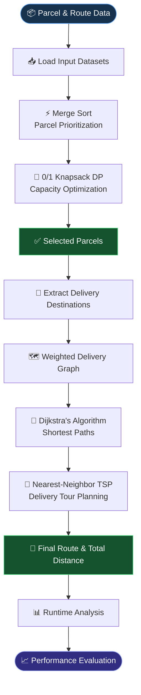
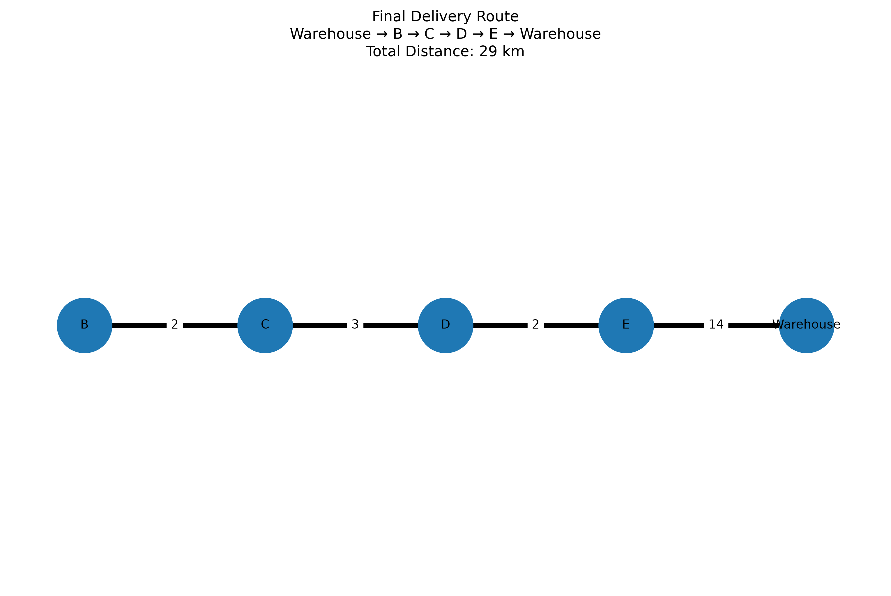

# 🚚 Mini Courier Planner

<p align="center">
  <a href="https://github.com/HarshKamboj25/Mini-Courier-Planner">
    
  </a>
</p>

<p align="center">
  <strong>From Parcel Selection to Route Optimization</strong><br>
  An Algorithm-Driven Courier Planning System
</p>

<p align="center">
  
  
  
  
</p>

<p align="center">
  <a href="#-about-the-project">Overview</a> •
  <a href="#-system-workflow">Workflow</a> •
  <a href="#-project-results">Results</a> •
  <a href="#-performance-analysis">Performance</a> •
  <a href="#-getting-started">Run Project</a>
</p>

---

## 📌 About the Project

Mini Courier Planner is a Python-based courier optimization system developed as a Design and Analysis of Algorithms (DAA) capstone project.

It combines sorting, dynamic programming, graph algorithms, and approximation techniques to solve two major courier-planning challenges:

- **📦 Parcel Optimization:** Select the most valuable combination of parcels without exceeding vehicle capacity.
- **🗺️ Delivery Optimization:** Determine an efficient customer visit order using shortest-path calculations and route planning.

The system transforms parcel and route datasets into a complete delivery plan, followed by empirical runtime evaluation.

---

## ⚡ System Workflow

The complete pipeline takes the system from raw input datasets to an optimized parcel selection and delivery route.



### 🔄 Algorithmic Pipeline

| Stage | Algorithm | Responsibility |
|---|---|---|
| 01 | ⚡ Merge Sort | Parcel prioritization using priority and deadlines |
| 02 | 🎒 0/1 Knapsack DP | Maximum-value parcel selection within capacity |
| 03 | 📍 Dijkstra | Shortest paths through the weighted graph |
| 04 | 🚚 Nearest-Neighbor TSP | Approximate customer delivery tour |
| 05 | ⏱️ Runtime Analysis | Performance evaluation across input sizes |

<details>
<summary><strong>🧠 Explore the algorithmic implementation</strong></summary>

### 1. Parcel Prioritization

Merge Sort arranges parcels in descending order of priority. When priorities are equal, parcels with earlier deadlines are placed first.

### 2. Capacity Optimization

The 0/1 Knapsack algorithm uses Dynamic Programming to select parcels while respecting the vehicle's maximum carrying capacity.

### 3. Shortest-Path Computation

Dijkstra's Algorithm calculates minimum travel distances between the warehouse and delivery locations using a weighted graph.

### 4. Delivery Tour Construction

The Nearest-Neighbor TSP heuristic selects the next closest unvisited customer and constructs a complete delivery tour, including the return to the warehouse.

### 5. Performance Evaluation

Execution times are measured for increasing input sizes to study the computational behaviour of the implemented algorithms.

</details>

---

## 📁 Repository Structure

```text
Mini-Courier-Planner/
│
├── datasets/
│   ├── parcels.csv
│   └── routes.csv
│
├── images/
│   ├── performance_results.csv
│   ├── route_visualization.png
│   └── runtime_chart.png
│
├── src/
│   ├── sorting.py
│   ├── knapsack.py
│   ├── dijkstra.py
│   ├── tsp.py
│   └── performance.py
│
├── mini_courier_planner.ipynb
├── requirements.txt
├── .gitignore
└── README.md
```

---

## 🛣️ Route Visualization

The project generates a visual representation of the final delivery route across the weighted delivery network.

<p align="center">
  
  <br>
  <sub>Generated delivery route visualization.</sub>
</p>

---

## 🚀 Getting Started

Follow these steps to run the project locally.

### 1. Clone the Repository

```bash
git clone https://github.com/HarshKamboj25/Mini-Courier-Planner.git
cd Mini-Courier-Planner
```

### 2. Create a Virtual Environment (Optional)

**Windows**

```bash
python -m venv .venv
.venv\Scripts\activate
```

**Linux / macOS**

```bash
python3 -m venv .venv
source .venv/bin/activate
```

### 3. Install Dependencies

```bash
pip install -r requirements.txt
```

### 4. Launch Jupyter Notebook

```bash
jupyter notebook mini_courier_planner.ipynb
```

### 5. Run the Pipeline

Execute the notebook cells sequentially to reproduce:

- Parcel prioritization
- Optimal parcel selection
- Shortest-path calculations
- Delivery route construction
- Runtime benchmarking and visualizations

---

## 🏁 Project Results

The implemented system produces the following results for the supplied dataset:

| Metric | Result |
|---|---|
| Total Input Parcels | 15 |
| Vehicle Capacity | 15 kg |
| Selected Parcels | P04, P12, P05, P02 |
| Total Selected Weight | 15 kg |
| Total Parcel Value | 390 |
| Customer Visit Order | Warehouse → B → C → D → E → Warehouse |
| **Total Route Distance** | **29 km** |

### 🚚 Final Delivery Traversal

```text
Warehouse
    ↓
    B → C → D → E
              ↓
Warehouse ← A ← C ← D
```

**Expanded Shortest-Path Traversal:**

```text
Warehouse → B → C → D → E → D → C → A → Warehouse
```

The Nearest-Neighbor TSP heuristic determines the customer visit order, while Dijkstra's Algorithm provides the shortest physical paths between consecutive locations.

---

## 📊 Performance Analysis

The four major algorithmic components were benchmarked using increasing input sizes:

<p align="center">
  
</p>

### 📋 Performance Results

The measured execution times are stored in:

`images/performance_results.csv`

<p align="center">
  
  <br>
  <strong>Figure 1. Performance Results Evidence</strong>
  <br>
  <sub>Individual runtime measurements for the implemented algorithms.</sub>
</p>

### 📈 Runtime Comparison

<p align="center">
  
  <br>
  <strong>Figure 2. Algorithm Runtime Comparison</strong>
  <br>
  <sub>Execution time comparison across different input sizes.</sub>
</p>

> **Key Observation:** The Nearest-Neighbor TSP component becomes the dominant computational bottleneck as the tested input size increases.

---

## 🛠️ Technology Stack

<p align="center">
  
  
  
  
  
  
</p>

| Technology | Application |
|---|---|
| **Python 3** | Core implementation |
| **Pandas** | Dataset handling and result tables |
| **NetworkX** | Weighted graph representation |
| **Matplotlib** | Route and performance visualization |
| **Jupyter Notebook** | Interactive execution and analysis |
| **Git & GitHub** | Version control and project hosting |

---

## 🔮 Future Enhancements

- 🚛 Multi-vehicle and multi-trip delivery planning
- ⚡ Shortest-path caching for improved efficiency
- 📅 Deadline-aware parcel selection
- 🧭 Comparison with advanced TSP heuristics
- 🌍 Evaluation using larger real-world delivery networks
- 🖥️ Interactive courier-planning dashboard

---

## 👨‍💻 Author

**Harsh Kamboj**

---

<p align="center">
  <strong>🚚 Mini Courier Planner</strong><br>
  <em>Prioritize. Optimize. Deliver.</em><br><br>
  Built with Python and Algorithmic Thinking.
</p>

<p align="center">
  <a href="#-mini-courier-planner">⬆ Back to Top</a>
</p>
